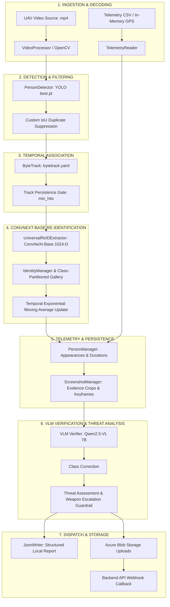

<div align="center">

# 🎯 Autonomous Aerial Target Detection, ConvNeXt-Base Re-Identification & VLM Threat Analysis Pipeline

### Comprehensive Technical System & Architecture Documentation

[](https://www.python.org/)
[](https://pytorch.org/)
[](https://ultralytics.com)
[](https://github.com/ifzhang/ByteTrack)
[](https://github.com/huggingface/pytorch-image-models)
[-FF6F00?style=for-the-badge)](https://ollama.ai/)
[](https://azure.microsoft.com/)

---

</div>

## 📑 Table of Contents
1. [Executive Summary & Purpose](#-executive-summary--purpose)
2. [High-Level Architecture](#-high-level-architecture)
3. [Core Subsystems & Module Breakdown](#-core-subsystems--module-breakdown)
   - [Object Detection & Bounding Box Filtering](#1-object-detection--bounding-box-filtering)
   - [Tracking & Temporal Association (ByteTrack)](#2-tracking--temporal-association-bytetrack)
   - [Deep Feature Re-Identification (ConvNeXt-Base)](#3-deep-feature-re-identification-convnext-base)
   - [Identity Management & Strict Class Barriers](#4-identity-management--strict-class-barriers)
   - [Visual Verification & Threat Assessment (Qwen2.5-VL 7B)](#5-visual-verification--threat-assessment-qwen25-vl-7b)
   - [Telemetry Fusion & Georeferencing](#6-telemetry-fusion--georeferencing)
   - [Worker Orchestration, Azure Storage & Cleanup](#7-worker-orchestration-azure-storage--cleanup)
4. [Noise Reduction & Sensitivity Tuning](#-noise-reduction--sensitivity-tuning)
5. [Data Flow & Pipeline Execution Lifecycle](#-data-flow--pipeline-execution-lifecycle)
6. [Directory Structure](#-directory-structure)
7. [API & Data Contract Specifications](#-api--data-contract-specifications)
8. [Installation & Operational Guide](#-installation--operational-guide)

---

## 🌟 Executive Summary & Purpose

The **Person Detection & Re-Identification Pipeline** is an end-to-end aerial surveillance analysis system designed for UAVs and drone reconnaissance flights. It ingests video feeds and synchronized telemetry data, detecting, tracking, and maintaining persistent identities for **Drones**, **Persons**, and **Vehicles** across long flights, flight cuts, and line-of-sight occlusions.

### Key Capabilities
- **Multi-Class Small Target Detection**: High-sensitivity aerial detection with tuned suppression of 1-frame background flickers.
- **Strict Class-Barrier Re-ID**: Powered by **ConvNeXt-Base (1024-D embeddings)** with strict barrier enforcement ensuring drones, vehicles, and persons never cross-contaminate gallery identities.
- **VLM Ground-Truth Verification & Tactical Assessment**: Integrates **Qwen2.5-VL 7B** via local Ollama inference to correct detector misclassifications (e.g., distinguishing drones from vehicles) and generate natural language threat assessments with non-null tactical action directives.
- **Dual-Server Worker Architecture**: Automatically polls job queues from Test and Production APIs, executes localized CUDA processing, uploads cropped visual evidence to Azure Blob Storage, and sends structured callbacks.

---

## 🏗️ High-Level Architecture



---

## 🧩 Core Subsystems & Module Breakdown

### 1. Object Detection & Bounding Box Filtering
- **Module**: `ml_pipeline/app/pipeline/detector.py` (`PersonDetector`, alias `ObjectDetector`)
- **Model**: Custom fine-tuned YOLO model (`ml_pipeline/app/downloaded_model/best.pt`).
- **Classes**: `drone` (0), `person` (1), `vehicle` (2).
- **Inference Setup**:
  - Dynamically targets CUDA device (`device=0`) when available.
  - Built-in IoU Non-Maximum Suppression (NMS) removes box clustering on high-contrast targets:
    $$\text{IoU} = \frac{\text{Area}(A \cap B)}{\text{Area}(A \cup B)} > 0.50 \quad\lor\quad \frac{\text{Area}(A \cap B)}{\min(\text{Area}(A), \text{Area}(B))} > 0.50$$
  - Filters degenerate zero-pixel boxes while preserving small-drone aerial coordinates.

### 2. Tracking & Temporal Association (ByteTrack)
- **Configuration**: `bytetrack.yaml` & `ml_pipeline/app/pipeline/bytetrack.yaml`
- **Algorithm**: ByteTrack two-stage association matching detections with Kalman filter trajectories.
- **Parameters**:
  - `tracker_type: bytetrack`
  - `track_high_thresh: 0.25`: Association threshold for primary high-confidence detections.
  - `track_low_thresh: 0.10`: Second association stage to recover targets through momentary occlusion.
  - `new_track_thresh: 0.25`: Sensitive threshold allowing fast-moving and distant drones to spawn tracks.
  - `track_buffer: 30`: Keeps lost tracks alive across 30 frames.
  - `match_thresh: 0.80`: Linear assignment Hungarian matching cost barrier.
  - `fuse_score: True`: Fuses detection confidence scores with motion costs.
- **Track Confirmation Gate**: `min_hits >= 2` (or configurable to `>= 5` for ultra-clean video rendering). Tentative 1-frame tracks are filtered out before downstream Re-ID and evidence recording.

### 3. Deep Feature Re-Identification (ConvNeXt-Base)
- **Module**: `ml_pipeline/app/pipeline/reid/reid_model.py` (`UniversalReIDExtractor`)
- **Backbone**: `timm` ConvNeXt-Base architecture (`convnext_base.fb_in22k_ft_in1k_384` / `convnext_base`).
- **Feature Space**: 1024-dimensional normalized $L_2$ feature vectors:
  $$\|f\|_2 = \sqrt{\sum_{i=1}^{1024} f_i^2} = 1.0$$
- **Preprocessing**: BGR $\rightarrow$ RGB conversion, Bicubic interpolation resizing to $384 \times 384$, ImageNet normalization ($\mu = [0.485, 0.456, 0.406]$, $\sigma = [0.229, 0.224, 0.225]$).

### 4. Identity Management & Strict Class Barriers
- **Module**: `ml_pipeline/app/pipeline/reid/identity_manager.py` & `embedding_database.py`
- **Cosine Similarity Association**:
  $$S_C(u, v) = \frac{u \cdot v}{\|u\|_2 \|v\|_2}$$
  Matches against existing identities above `similarity_threshold = 0.57`.
- **Strict Class Barriers**:
  ```python
  # Fast-path tracker_id check
  if existing.obj_class and obj_class and existing.obj_class != obj_class:
      # Blocked: drone cannot reuse vehicle identity
  ```
  Prevents cross-class identity pollution across aerial cuts.
- **Exponential Moving Average (EMA) Feature Bank**:
  $$\vec{e}_{\text{gallery}} \leftarrow (1 - \alpha)\vec{e}_{\text{gallery}} + \alpha \vec{e}_{\text{new}} \quad (\alpha = 0.30)$$
  Stores up to 10 diverse aspect-ratio keyframe embeddings per target to support varying viewing angles.

### 5. Visual Verification & Threat Assessment (Qwen2.5-VL 7B)
- **Module**: `ml_pipeline/app/pipeline/vlm_verifier.py` & `ml_pipeline/app/worker/worker.py`
- **Engine**: Local Ollama server (`http://localhost:11434/api/generate`) running `qwen2.5vl:7b`.
- **Context-Safe Image Preprocessing**: Keyframe context images and target crops (`best_detection.jpg`) are constrained to $512 \times 512$ JPEG buffers to strictly respect Ollama's 4096-token context limit without `400 Bad Request` exceptions.
- **Dual Responsibilities**:
  1. **Visual Class Verification**: Ground-truth classification into `['drone', 'person', 'vehicle']`, automatically correcting YOLO classification mistakes.
  2. **Threat Assessment**: Evaluates behavior, proximity to assets, and weapons.
- **Weapon Escalation Guardrail**:
  Scans descriptions for tactical indicators (e.g., `rifle`, `gun`, `armed with`, `firing`) and escalates threat levels:
  - Active firing $\rightarrow$ `CRITICAL` (Level 4)
  - Visible weapons $\rightarrow$ `HIGH` (Level 3)

### 6. Telemetry Fusion & Georeferencing
- **Module**: `ml_pipeline/app/pipeline/telemetry.py` (`TelemetryReader`)
- **Data Ingestion**: Parses offline flight logs (`offline_teledata_*.csv` / `offline_flightdata_*.csv`).
- **Temporal Alignment**: Computes UTC video start epoch and aligns milliseconds to GPS timestamps.
- **Spatial Geolocation**: Projects GPS coordinates (latitude, longitude, altitude, heading, distance) onto each appearance record.

### 7. Worker Orchestration, Azure Storage & Cleanup
- **Module**: `ml_pipeline/app/worker/worker.py` & `ml_pipeline/app/app.py`
- **Multi-Server Polling**: Interleaves task acquisition between Testing and Production backend queues.
- **Azure Blob Storage**: Uploads `best_detection.jpg`, `first_detection.jpg`, `middle_detection.jpg`, and `last_detection.jpg` to SAS URLs and packages them into an evidence URL array.
- **Automated Space Management**: A `finally` cleanup block removes downloaded input videos, cropped image folders, and annotated videos post-job.

---

## 🎯 Noise Reduction & Sensitivity Tuning

The system incorporates dual operating profiles tuned for aerial operations:

```
+----------------------------------------------------------------------------------------------------+
| AERIAL BALANCED PROFILE (Default Production)                                                       |
|   • YOLO conf: 0.25 - 0.35              • ByteTrack track_high_thresh: 0.25                        |
|   • min_box_width / height: 0 (no drop) • ByteTrack new_track_thresh: 0.25                         |
|   • min_hits gate: >= 2 frames          • VLM Keyframe Resize: max 512x512                         |
+----------------------------------------------------------------------------------------------------+
| HIGH-STABILITY URBAN PROFILE                                                                       |
|   • YOLO conf: 0.55                     • ByteTrack track_high_thresh: 0.55                        |
|   • IoU NMS threshold: 0.50             • ByteTrack new_track_thresh: 0.60                         |
|   • min_hits gate: >= 5 frames          • Duration Gate: total_duration >= 1.5s                    |
+----------------------------------------------------------------------------------------------------+
```

---

## 🔄 Data Flow & Pipeline Execution Lifecycle

1. **Task Polling**: Background worker requests pending jobs from backend server.
2. **Resource Retrieval**: `downloader.py` pulls remote MP4 video, telemetry CSV, and custom model weights (if specified).
3. **Frame-by-Frame Processing Loop**:
   - Frames sampled according to `target_fps` (e.g., 10 FPS).
   - Detections generated and duplicate boxes merged via IoU NMS.
   - ByteTrack assigns tracklets; `track_hits` counter filters transient flickers.
   - Target crops extracted and passed to ConvNeXt-Base for 1024-D embedding generation.
   - `IdentityManager` matches or registers global target IDs (`Drone_001`, `Person_001`, `Vehicle_001`).
   - Telemetry reader tags geographic coordinates and distances.
4. **Finalization & Keyframe Extraction**:
   - `person_manager.finalize()` calculates entry, exit, duration, and re-identification counts.
   - Behavior video clips and candidate keyframes extracted.
5. **VLM Verification & Threat Analysis**:
   - Resized keyframes and target close-ups sent to `qwen2.5vl:7b`.
   - VLM validates or corrects target class and assigns severity (`LOW`, `MEDIUM`, `HIGH`, `CRITICAL`).
   - Weapon escalation guardrail applied.
6. **Delivery & Cleanup**:
   - Local JSON structured results written.
   - Evidence uploaded to Azure Blob containers.
   - Job status reported as `COMPLETED` to backend webhook.
   - Temporary on-disk video and crop artifacts deleted.

---

## 📁 Directory Structure

```
person-detection-reid-pipeline/
├── bytetrack.yaml                          # Root ByteTrack tracker parameters
├── PROJECT_DOCUMENTATION.md                # Comprehensive system documentation
├── README.md                               # Project summary and links
├── requirements.txt                        # Python dependencies
├── run_dji_pipeline.py                     # Local standalone test harness
├── ml_pipeline/
│   └── app/
│       ├── app.py                          # Worker entry point and polling loop
│       ├── downloader.py                   # Multi-part download client
│       ├── main.py                         # Standalone pipeline CLI runner
│       ├── bytetrack.yaml                  # Local tracker profile
│       ├── downloaded_model/               # Cached detection models (best.pt)
│       ├── models/                         # ReID checkpoints & weights
│       ├── vlm_models/                     # Ollama model manifests
│       ├── pipeline/
│       │   ├── detector.py                 # YOLO + IoU duplicate suppression
│       │   ├── video_processor.py          # Main processing orchestrator
│       │   ├── person_manager.py           # Target trajectory and appearance state
│       │   ├── telemetry.py                # Flight telemetry & GPS fusion
│       │   ├── screenshot_manager.py       # Evidence cropping and keyframe sampling
│       │   ├── vlm_verifier.py             # Qwen2.5-VL 7B verification engine
│       │   ├── json_writer.py              # Output report generator
│       │   ├── utils.py                    # Formatting and tactical action helpers
│       │   └── reid/
│       │       ├── config.py               # ReID thresholds, alphas, and dimensions
│       │       ├── reid_model.py           # ConvNeXt-Base 1024-D feature extractor
│       │       ├── identity_manager.py     # Class barriers and gallery assignment
│       │       ├── embedding_database.py   # Multi-embedding feature bank
│       │       ├── similarity.py           # Cosine similarity metrics
│       │       └── utils.py                # Bounding box cropping and padding
│       └── worker/
│           ├── worker.py                   # Job processing, VLM prompts, Azure uploads
│           ├── api_client.py               # REST API client (Test & Prod queues)
│           └── result_builder.py           # JSON callback formatting
```

---

## 📋 API & Data Contract Specifications

### Webhook Completion Payload Schema

```json
{
  "status": "COMPLETED",
  "results": [
    {
      "id_number": "Drone_004",
      "class": "drone",
      "entry_time": "00:00:08",
      "exit_time": "00:00:10",
      "total_duration": 1.8,
      "reidentification_count": 0,
      "severity_level": 2,
      "severity": "MEDIUM",
      "description": "A small, rectangular drone with a dark body and white markings flying low over open ground.",
      "suggest_action": "MONITOR - Maintain surveillance on the drone's movements and altitude.",
      "file_name": "Drone_004_best_sec_8.jpg",
      "file_size": 184520,
      "file_url": "https://storageaccount.blob.core.windows.net/evidence/flight_99/Drone_004.jpg",
      "evidence": [
        "https://storageaccount.blob.core.windows.net/evidence/flight_99/Drone_004_first.jpg",
        "https://storageaccount.blob.core.windows.net/evidence/flight_99/Drone_004_best.jpg"
      ],
      "appearances": [
        {
          "appearance_id": 1,
          "entry_time": "00:00:08",
          "exit_time": "00:00:10",
          "duration": 1.8,
          "confidence": 0.44,
          "severity_level": 2,
          "severity": "MEDIUM",
          "entry_location": {
            "lat": 18.52043,
            "lon": 73.85674,
            "alt": 42.1,
            "heading": 135.0,
            "distance": 85.4,
            "detection_time": "2026-11-24T04:41:20Z"
          },
          "exit_location": {
            "lat": 18.52049,
            "lon": 73.85680,
            "alt": 42.5,
            "heading": 136.2,
            "distance": 88.1,
            "detection_time": "2026-11-24T04:41:22Z"
          }
        }
      ]
    }
  ]
}
```

---

## 🛠️ Installation & Operational Guide

### 1. Environment Setup
```bash
# Clone the repository
git clone https://github.com/girish8055-py/person-detection-reid-pipeline.git
cd person-detection-reid-pipeline

# Create and activate Python virtual environment
python3 -m venv .venv
source .venv/bin/activate

# Install dependencies
pip install -r requirements.txt
```

### 2. Configure Local Ollama VLM
Ensure Ollama is serving locally with the `qwen2.5vl:7b` model available:
```bash
# Verify models in Ollama
ollama list

# Test Qwen2.5-VL 7B
ollama run qwen2.5vl:7b "Hello"
```

### 3. Run Standalone Test Execution
To run processing directly on a local test video:
```bash
python run_dji_pipeline.py
```

### 4. Run Production Background Worker
To start the automatic multi-server job polling worker:
```bash
python ml_pipeline/app/app.py
```

---

<div align="center">

*Maintained for Autonomous UAV Intelligence, Persistent Identity Tracking & Actionable Field Assessment.*

</div>
