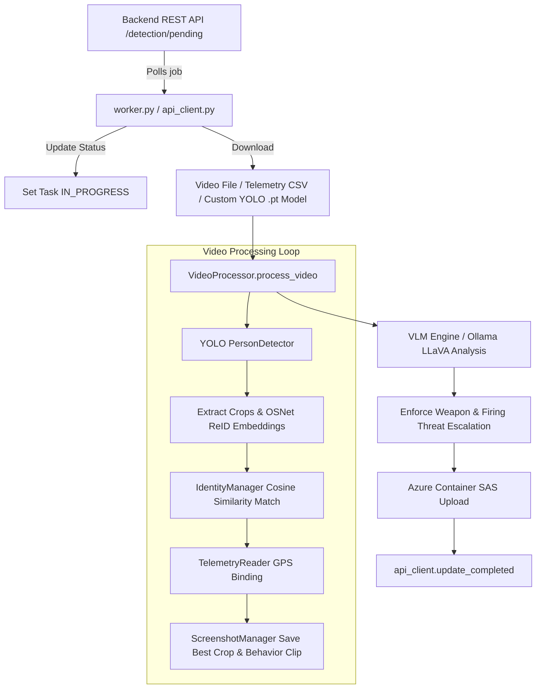

# Threat Detection & Person/Vehicle Re-Identification Pipeline (ML Pipeline)
## Technical Documentation & Managerial Reference

---

## 1. Executive Summary & System Overview

The **Threat Detection and Re-Identification Pipeline** is an enterprise-grade military and security surveillance processing system designed to analyze aerial drone video feeds, track human targets and vehicles, re-identify targets across tracking dropouts/occlusions, bind GPS telemetry, evaluate threat severity via Vision-Language Models (VLM), and interface automatically with a cloud backend via REST APIs and Azure Blob Storage.

### Key Capabilities:
- **Object Detection**: Custom fine-tuned YOLO model identifying targets (`person`, `vehicle`, etc.) with customizable confidence thresholds.
- **Deep Re-Identification (ReID)**: OSNet (`osnet_x1_0`) feature extraction generating 512-dimensional feature embeddings. Cosine similarity matching maintains target identity across camera drops, occlusions, and multi-sector appearances.
- **GPS & Telemetry Synchronization**: Synchronizes video timestamps with drone telemetry logs (CSV or API payload) to embed real-time latitude, longitude, altitude, and ISO timestamps for every appearance.
- **VLM Visual Analysis & Safety Net Guardrails**: Local Ollama VLM (LLaVA / Qwen2-VL) generates concise situational summaries and tactical recommendations. Safety net keyword scanners enforce threat level escalation (`HIGH`/`CRITICAL`) whenever weapons or active firing are detected.
- **Cloud Worker Integration**: Automated polling worker (`worker.py` / `api_client.py`) fetching pending jobs, updating status, uploading keyframe evidence to Azure Container SAS Storage, and returning structured JSON outputs.

---

## 2. Directory & File Structure

```
ml_pipeline/
│
├── CODE_EXPLANATION.md                   # Complete system technical reference (this file)
└── app/
    ├── main.py                           # Standalone local script for video processing & GUI demo
    ├── app.py                            # Flask server entrypoint (optional web interface)
    ├── downloader.py                     # Utility functions to download videos, files, and model weights
    ├── admin_output_debug.json           # Local debug payload generated during worker execution
    │
    ├── worker/                           # Background Cloud Polling & API Integration
    │   ├── __init__.py
    │   ├── api_client.py                 # REST client for backend API communication
    │   ├── worker.py                     # Multi-threaded worker loop, Azure uploader & VLM integration
    │   └── result_builder.py             # Formatter converting internal state into API output schema
    │
    ├── pipeline/                         # Core Machine Learning & Vision Processing Engine
    │   ├── __init__.py
    │   ├── video_processor.py            # High-level pipeline coordinator orchestrating video execution
    │   ├── detector.py                   # YOLO detector wrapper for frame-by-frame object detection
    │   ├── identity_manager.py           # Deep ReID embedding extractor & cosine distance resolver
    │   ├── person_manager.py             # Target lifecycle tracking, duration, and trajectory manager
    │   ├── telemetry.py                  # GPS telemetry parser and epoch timestamp synchronizer
    │   ├── vlm_verifier.py               # VLM object class verifier and classification validator
    │   ├── json_writer.py                # Local JSON results exporter
    │   ├── screenshot_manager.py         # Keyframe crop extractor, image quality evaluator & behavior clip recorder
    │   ├── utils.py                      # Common helper utilities (time formatting, severity escalation, text wrapping)
    │   └── reid/                         # Deep ReID Neural Network Architecture
    │       ├── __init__.py
    │       ├── config.py                 # ReID model parameters and class prefixes
    │       ├── feature_extractor.py      # OSNet PyTorch model loader and inference wrapper
    │       ├── osnet.py                  # OSNet neural network architecture definition
    │       └── utils.py                  # Image pre-processing & crop generator functions
    │
    ├── models/                           # Default model weights directory (e.g. OSNet ReID weights)
    ├── downloaded_model/                 # Workspace for models dynamically fetched from server SAS URLs
    ├── inputs/ / output/ / uploads/       # Directory workspaces for temporary job files and keyframes
    └── scratch/                          # Internal test and diagnostic scripts
```

---

## 3. End-to-End Data Flow & Worker Pipeline



### Detailed Pipeline Steps:
1. **Worker Polling**: `worker_loop()` in `worker.py` periodically queries the backend server via `fetch_pending_job()`.
2. **Job Acquisition & Lock**: Upon receiving a task, the worker locks execution (preventing concurrent overlap) and notifies the backend (`IN_PROGRESS`).
3. **Artifact Acquisition**: Downloads the surveillance video, optional telemetry CSV, and custom fine-tuned YOLO model weights (if specified by SAS URL).
4. **Frame Processing**: `VideoProcessor` iterates through video frames at target sampling rate (default 10 FPS).
5. **Detection & ReID**: `PersonDetector` detects targets. `IdentityManager` extracts OSNet embeddings for each crop and compares them against known person/vehicle profiles using cosine similarity.
6. **Telemetry Mapping**: `TelemetryReader` calculates absolute epoch timestamps for frames and matches them to drone flight logs to bind `lat`, `lon`, and `alt`.
7. **Best Evidence Capture**: `ScreenshotManager` saves the highest-confidence keyframe crop and records a 5-second video snippet for each target.
8. **VLM Threat Assessment**: Keyframes are transmitted to the local VLM engine (LLaVA/Qwen2-VL) via Ollama. The model returns a situational description and tactical action recommendation.
9. **Threat Escalation Guardrail**: `enforce_weapon_escalation()` scans the description for weapon/firing keywords and automatically overrides incorrect `LOW` ratings to `HIGH` or `CRITICAL`.
10. **Cloud Upload & Finalization**: Screenshots are uploaded to Azure Blob Storage via SAS URL, and final results JSON is submitted to the backend via `update_completed()`.

---

## 4. Complete Catalog of Modules & Functions

### A. Worker Module (`ml_pipeline/app/worker/`)

#### [`api_client.py`](file:///d:/deployment_model/ml_pipeline/app/worker/api_client.py)
- **`fetch_active_model_url(base_url)`**: Queries `/models?is_active=true` to retrieve active detection model weights and SAS tokens.
- **`fetch_pending_job(base_url)`**: Polls `/detection/pending` endpoint for unassigned tasks. Returns task metadata dictionary.
- **`update_status(task_id, status, base_url)`**: Sends HTTP `PUT` request to update task status (`IN_PROGRESS`, `PENDING`, `COMPLETED`, `FAILED`).
- **`update_completed(task_id, results, files, file_sizes, base_url)`**: Submits final structured results JSON and file metadata to backend upon job completion.
- **`update_failed(task_id, message, base_url)`**: Reports execution failure and error details to backend.

#### [`worker.py`](file:///d:/deployment_model/ml_pipeline/app/worker/worker.py)
- **`enforce_weapon_escalation(description, action, severity, target_id)`**: Inspects VLM text for weapon/firearm keywords and escalates low threat ratings to `HIGH` or `CRITICAL`.
- **`get_vlm_behavior_description_and_action(person_result, keyframe_paths)`**: Formats keyframe images and prompts local Ollama VLM instance for visual analysis. Includes smart fallback logic if VLM is offline.
- **`upload_to_azure(file_path, filename, flight_id, sas_url, base_url)`**: Uploads image evidence to Azure Blob Storage container using BlockBlob headers.
- **`worker_loop(app_module, server_name, base_url)`**: Continuous polling loop handling task lifecycle, error recovery, and retries.
- **`start_worker(app_module)`**: Spawns background daemon threads for Test and Production server instances.

#### [`result_builder.py`](file:///d:/deployment_model/ml_pipeline/app/worker/result_builder.py)
- **`build_result_json(persons)`**: Transforms internal `PersonManager` target dictionaries into the standardized REST API payload format.

---

### B. Pipeline Core Engine (`ml_pipeline/app/pipeline/`)

#### [`video_processor.py`](file:///d:/deployment_model/ml_pipeline/app/pipeline/video_processor.py)
- **`VideoProcessor.__init__(model_path, reid_weights_path, confidence, target_fps)`**: Initializes YOLO detector and OSNet ReID model.
- **`process_video(...)`**: Main orchestrator method executing video decoding, detection, tracking, telemetry sync, keyframe extraction, and result generation.
- **`_rename_identity(persons, old_id, new_id, p_data, output_folder)`**: Re-keys target IDs when class corrections occur (e.g. `Person_001` -> `Vehicle_001`) and renames local disk folders.

#### [`detector.py`](file:///d:/deployment_model/ml_pipeline/app/pipeline/detector.py)
- **`PersonDetector.__init__(model_path, confidence, device)`**: Loads YOLO PyTorch/Ultralytics model on CUDA or CPU.
- **`detect(frame)`**: Runs object detection on a BGR image frame. Returns list of bounding box dicts (`bbox`, `confidence`, `class`, `track_id`).

#### [`identity_manager.py`](file:///d:/deployment_model/ml_pipeline/app/pipeline/identity_manager.py)
- **`IdentityManager.__init__(weights_path, metric, threshold)`**: Instantiates OSNet feature extractor and cosine distance matcher.
- **`resolve_batch(track_ids, crops_bgr, bboxes, confidences, timestamp, classes)`**: Matches detected crops against historical gallery embeddings to resolve persistent target IDs across frame gaps.

#### [`person_manager.py`](file:///d:/deployment_model/ml_pipeline/app/pipeline/person_manager.py)
- **`PersonManager`**: Maintains temporal tracking state for detected targets, including entry/exit times, total duration, appearance trajectory points, and re-identification counts.

#### [`telemetry.py`](file:///d:/deployment_model/ml_pipeline/app/pipeline/telemetry.py)
- **`TelemetryReader`**: Loads telemetry CSV or API JSON arrays, parses timestamps, and interpolates `get_position(timestamp)` for lat/lon/alt lookup.
- **`parse_video_start_epoch(video_path, flightdata_path, flightdata_list)`**: Extracts absolute UTC start time of video recording from MP4 creation metadata or drone telemetry logs.

#### [`vlm_verifier.py`](file:///d:/deployment_model/ml_pipeline/app/pipeline/vlm_verifier.py)
- **`verify_object_class(crop_bgr, initial_class)`**: Prompts VLM to verify if a cropped target is correctly classified (e.g. distinguishing a person from a vehicle).

#### [`screenshot_manager.py`](file:///d:/deployment_model/ml_pipeline/app/pipeline/screenshot_manager.py)
- **`ScreenshotManager`**: Selects and saves the clearest high-confidence crop image for each target and records a 5-second MP4 snippet.

#### [`downloader.py`](file:///d:/deployment_model/ml_pipeline/app/downloader.py)
- **`download_video(url, task_id)`**, **`download_file(url, filename)`**, **`download_model(url, filename)`**: Helper routines handling HTTP downloads with streaming and timeout protections.

---

## 5. Executive & Manager Q&A / Technical Cheat Sheet

### Q1: What machine learning models are used in this pipeline?
- **Detection**: Fine-tuned YOLO object detector (`best.pt`) optimized for aerial surveillance feeds.
- **Re-Identification (ReID)**: OSNet (`osnet_x1_0`) trained on Market-1501 dataset, producing 512-D feature vectors for person/vehicle matching.
- **Vision-Language Model (VLM)**: LLaVA / Qwen2-VL running via local Ollama endpoint for zero-shot visual situational analysis.

### Q2: How does the system handle temporary network outages or server drops?
- If network connections fail during task status updates or video downloads, `worker.py` catches the network exception, logs a warning, and resets the task status back to `PENDING` so it can be retried on the next polling cycle without losing the job.

### Q3: What prevents an armed threat from being accidentally reported as "LOW" severity?
- The system incorporates a safety net function (`enforce_weapon_escalation`). Every VLM response is scanned for weapon and firing keywords (`gun`, `rifle`, `pistol`, `firing`, `armed`). If any keyword is detected, the severity level is forcibly escalated to `HIGH` or `CRITICAL`.

### Q4: How are video frames correlated with drone GPS location?
- The `TelemetryReader` parses the absolute epoch creation time of the video file (`parse_video_start_epoch`) and adds frame relative playback milliseconds (`CAP_PROP_POS_MSEC`). This produces an exact UTC timestamp for every frame, which is matched to drone GPS coordinates (`lat`, `lon`, `alt`).

### Q5: What are the hardware requirements for deployment?
- **Recommended**: NVIDIA GPU with at least 8 GB VRAM (CUDA enabled) for real-time YOLO detection and OSNet ReID embedding generation, plus 16 GB System RAM.
- **Fallback**: The pipeline automatically falls back to CPU execution if CUDA is unavailable.

---

## 6. Comprehensive Network Offline & System Failure Modes Matrix

### A. Network & Offline Failure Modes

| Failure Scenario | Root Cause | How System Handles It | Potential Risk & System Behavior |
| :--- | :--- | :--- | :--- |
| **No Network Connection (Complete Offline)** | Internet down, Wi-Fi lost, or ground station disconnected. | `fetch_pending_job` catches `requests.exceptions.RequestException`, logs warning ("Offline / Connection Refused"), and returns `None`. Worker sleeps 5s and retries polling cleanly. | **Zero Crash**. Daemon stays alive in safe idle state until network restores. |
| **Network Drops Mid-Download (Video / Model)** | Network drops while streaming video or model chunks. | `download_file` cleans up partial `.tmp` or incomplete files and raises `RuntimeError`. `worker.py` detects network keywords, resets task status to `PENDING` (or logs warning if server unreachable), sleeps 30s, and retries. | Partial/corrupt files are automatically deleted so corrupted media is never passed to YOLO. |
| **Backend REST API Server Offline / 500 Error** | IDMS backend API server down, restarting, or returning 500 error. | All API methods (`fetch_pending_job`, `update_status`, `update_completed`) catch HTTP exceptions, return `False`/`None`, and log detailed errors. | Tasks remain safely queued on backend until server comes back online. |
| **Azure Container SAS Token Expired (403 Forbidden)** | Azure SAS token in job payload or env var has expired. | `upload_to_azure` catches 403 HTTP error, logs `[AZURE SAS EXPIRED]` warning, and falls back to server-side multipart file upload route. | Pipeline completes job successfully despite Azure auth expiration. |

---

### B. Hardware, Data & Infrastructure Failure Modes

| Failure Scenario | Root Cause | How System Handles It | Potential Risk & System Behavior |
| :--- | :--- | :--- | :--- |
| **Local VLM Service Offline (Ollama Down)** | Ollama service not running on `localhost:11434` or GPU OOM. | Retries VLM HTTP call 3 times. If still unavailable, activates **Smart Fallback Engine**. Computes trajectory spread, duration, loitering vs roaming state, and ReID count to produce rich description & tactical command locally. | **Zero Failure**. Pipeline output JSON is generated successfully even without Ollama. |
| **Custom Model Weights URL 404 / Invalid** | Backend provided broken `model_url` or missing SAS token. | Worker attempts download. If download fails, logs error ("Failed to download requested detection model") and raises exception. Task is marked `FAILED` with error message reported to backend. | System does not silently fall back to wrong model when a specific fine-tuned model was requested, preventing silent misdetection. |
| **Missing / Corrupted Telemetry CSV** | Telemetry CSV missing, invalid headers, or corrupt lines. | `TelemetryReader` catches file/CSV errors gracefully. Telemetry remains `None` or partial. Pipeline continues object tracking normally, simply omitting GPS lat/lon/alt fields. | Fully backward compatible. |
| **Corrupted Video Stream / 0-Byte Video File** | OpenCV cannot decode frame (`ret == False` or 0 byte file). | `cv2.VideoCapture` read check `if not ret: break` terminates frame loop gracefully. `person_manager.finalize()` flushes accrued targets. | Output JSON generated cleanly for processed frames. |
| **Disk Full / Permission Denied** | Disk space depleted while writing output crops/clips. | File open / image write (`cv2.imwrite`, `json.dump`) caught in local `try...except` blocks with warning logs. Worker continues remaining steps. | Monitoring disk space recommended for heavy video workloads. |
| **CUDA / PyTorch GPU Out-of-Memory (OOM)** | High resolution video or large batch saturates GPU VRAM. | PyTorch ReID extractor falls back or raises exception. `worker_loop` top-level `try...except` catches error, marks task `FAILED`, releases memory, and proceeds to next job. | Worker thread stays alive for subsequent jobs. |

---
*Documentation compiled and verified for ML Pipeline release.*
